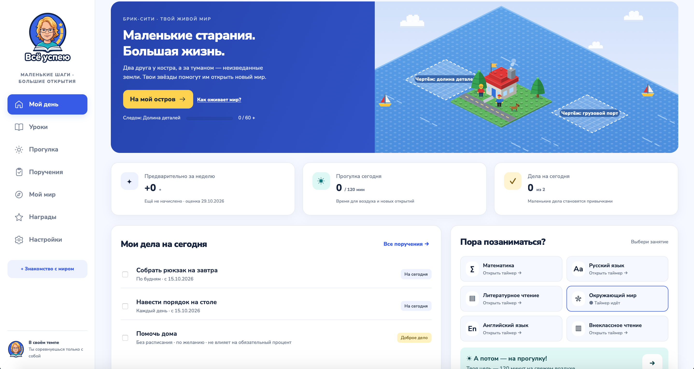

<p align="center">
  
</p>

<h1 align="center">Всё успею</h1>

<p align="center">Занятия, полезные привычки и маленькие победы — в одном приложении для ребёнка и взрослого.</p>

<p align="center">
  <a href="#возможности">Возможности</a> ·
  <a href="#локальный-запуск">Локальный запуск</a> ·
  <a href="https://github.com/matovykh/time-for-everything_deploy">Установка в Docker</a> ·
  <a href="docs/USER-GUIDE.md">Руководство пользователя</a>
</p>



Ребёнок отмечает занятия и поручения, следит за своим прогрессом и получает звёзды, за которые развивает сказочный мир. Взрослый помогает с заданиями и проверяет уроки. Главное — регулярность и качество, а не рекорды скорости.

> **Статус: MVP.** Основные функции реализованы, но это ещё не готовый к публичному распространению продукт. Перед использованием с реальными детскими данными проверьте свою установку по [чек-листу развёртывания](https://github.com/matovykh/time-for-everything_deploy/blob/main/docs/DEPLOYMENT.md). Наличие тестов не заменяет проверку реальных Supabase Auth, базы и сетевого доступа.

## Возможности

- **Занятия и таймеры.** Пауза, продолжение и сохранение времени; у каждого занятия свой серверный таймер. Можно добавить время вручную.
- **История и статистика.** Записи занятий и графики помогают видеть прогресс.
- **Поручения.** Разовые дела и расписания: ежедневно, по будням, раз в неделю или в выбранные дни.
- **Награды.** Еженедельные звёзды за уроки, прогулки и поручения по фиксированным правилам. Начисления выполняет сервер; все операции видны в журнале.
- **Четыре сказочных мира.** Бесплатная коллекция, улучшения за звёзды и анимация. Новый пользователь начинает с нулевым балансом.
- **Роли ребёнка и взрослого.** Проверка уроков, настройка объёма задания и часового пояса доступны взрослому.
- **Оформление.** Светлая, тёмная и системная темы.

### Что пока не входит

Нет самостоятельной регистрации и восстановления пароля: пользователей создаёт оператор в Supabase Dashboard. Связи взрослый–ребёнок настраиваются через SQL, а не через интерфейс. Также нет AI-оценки наград и экспорта или удаления данных через API. Раздел подключений показывает статус, но не меняет ключи и файлы конфигурации.

Подробнее — [архитектура и ограничения](docs/ARCHITECTURE.md).

## Как устроен проект

**React + TypeScript + Vite** отвечают за интерфейс, **FastAPI + SQLAlchemy** — за API и правила приложения. Данные хранятся во внешнем **Supabase PostgreSQL**, вход работает через **Supabase Auth**. Backend может раздавать собранный интерфейс и API с одного адреса.

Два репозитория выполняют разные задачи:

| Репозиторий | Назначение |
|---|---|
| **Этот проект** | Код приложения, SQL-миграции, тесты и Source CI |
| [time-for-everything_deploy](https://github.com/matovykh/time-for-everything_deploy) | Docker-образ, Compose, установка на Mac/Linux/Synology и выпуск релизов |

`prototype/` — исторический визуальный макет с демо-данными в браузере, **не рабочее приложение**. Корневой `package.json` относится к нему; команды рабочего интерфейса запускаются в `frontend/`.

## Локальный запуск

Нужны **Python 3.13**, **Node.js 24** и отдельный проект **Supabase для разработки**. Команды ниже выполняются из корня репозитория.

### 1. Установите зависимости

```sh
python3.13 -m venv backend/.venv
backend/.venv/bin/pip install -r backend/requirements-dev.txt
npm --prefix frontend ci
npm --prefix frontend run build
cp .env.example .env
chmod 600 .env
```

### 2. Настройте подключение

Откройте `.env`, заполните `DATABASE_URL`, `SUPABASE_URL` и `SUPABASE_PUBLISHABLE_KEY` своего dev-проекта. Для локального HTTP задайте:

```dotenv
APP_ENV=development
COOKIE_SECURE=false
APP_BASE_URL=http://127.0.0.1:8000
```

Не добавляйте `.env` и реальные ключи в Git. Примените [миграции](supabase/README.md) и создайте пользователя в Supabase Dashboard перед первым входом. Не используйте рабочую базу для разработки и тестов.

### 3. Запустите приложение

```sh
cd backend
CONFIG_FILE="$PWD/../.env" .venv/bin/uvicorn app.main:app --host 127.0.0.1 --port 8000
```

Откройте **<http://127.0.0.1:8000/>**. Адрес в браузере должен совпадать с `APP_BASE_URL`.

- `/api/v1/health/live` — процесс работает.
- `/api/v1/health/ready` — готовность подключений; при проблеме возвращает `503` с подсказками.
- `/api/v1/docs` — документация API в режиме разработки.

Горячая перезагрузка через Vite, полный список настроек и тесты — в [руководстве разработчика](docs/DEVELOPMENT.md). Для Docker используйте [deploy-проект](https://github.com/matovykh/time-for-everything_deploy), а не эти команды.

## Проверки

```sh
# Backend: из корня репозитория
(cd backend && .venv/bin/python -m pytest)

# Frontend
npm --prefix frontend run typecheck
npm --prefix frontend test
npm --prefix frontend run test:qa
npm --prefix frontend run build
```

Для PostgreSQL есть отдельные наборы: они пересоздают тестовую схему и должны запускаться **только на одноразовой тестовой БД**. Инструкции и ограничения — [DEVELOPMENT.md](docs/DEVELOPMENT.md) и [tests/README.md](tests/README.md).

## Документация

| Документ | Для чего |
|---|---|
| [Руководство пользователя](docs/USER-GUIDE.md) | Работа ребёнка и взрослого с приложением |
| [Разработка](docs/DEVELOPMENT.md) | Настройка окружения, запуск и проверки |
| [Архитектура](docs/ARCHITECTURE.md) | Модули, данные, безопасность и ограничения |
| [HTTP API](docs/API.md) | Контракт `/api/v1` |
| [Миграции](supabase/README.md) | Подготовка и обновление базы |
| [Deploy-проект](https://github.com/matovykh/time-for-everything_deploy) | Сборка, установка, обновление и откат |
| [Все документы](docs/README.md) | Полный индекс документации |

## Структура

```text
frontend/    Рабочий интерфейс React
backend/     API FastAPI и backend-тесты
supabase/    SQL-миграции
scripts/     Инструменты миграций и сброса dev-базы
tests/       Независимые проверки QA и безопасности
docs/        Документация
prototype/   Исторический макет
logos/       Логотипы и аватар
```

Правила работы с кодом — [CONTRIBUTING.md](CONTRIBUTING.md). Сообщения об уязвимостях — [SECURITY.md](SECURITY.md).

## Права и распространение

Лицензия приложения пока не выбрана. Планируется использование в закрытом контуре; свободное распространение не заявлено. Доступ к репозиторию сам по себе не предоставляет разрешения на использование, копирование или распространение — условия необходимо согласовать с владельцем.

Сторонние компоненты сохраняют собственные лицензии. Уведомления для поставляемых Unovis и Nunito Sans находятся в [docs/licenses/](docs/licenses/). Права на логотипы и аватар необходимо подтвердить перед публичным распространением.
